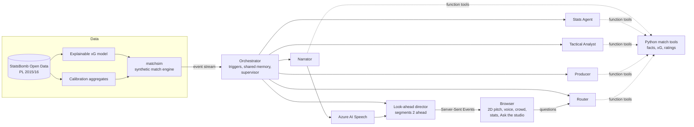

# Inside the Game: a live match broadcast run by five AI agents

Submission for the **Microsoft x Premier League "Inside the Game" Developer Hackathon**.

**Live demo:** https://inside-the-game.thankfulplant-70010164.francecentral.azurecontainerapps.io/
**Demo video:** _link added at submission_

A synthetic, Premier League-calibrated football match plays on a 2D pitch at real football
speed, and a studio of **five Microsoft Foundry agents** covers it live: an English
commentator with subtitles in six languages, a stats analyst, a tactical analyst, a producer
who builds each viewer's own show, and a router that answers viewer questions. Every number
on screen is computed in Python from the event stream; the agents write, they never invent.

> All clubs, players and managers are fictional (the *Albion Football League*). No Premier
> League name, logo, footage or data is used in the app.

---

## What you see

- **The match, live.** A 2D pitch at real speed: a 30 m pass takes about two seconds, nobody
  runs faster than about 8.5 m/s. Set pieces are set up before they are taken (free-kick
  wall at 10 yards, corners, penalties), kick-offs follow the Laws (each team in its own
  half), the offside line appears at the moment of the pass, the referee whistles fouls,
  offsides and the end of each half.
- **Three paces.** *Full match* (every action, about 45 min), *Extended highlights* (about
  13 min) and *Key moments only* (about 6 min). The highlights choose which moves to show
  (a move that ends in a shot shows its whole build-up) and cut between them like a TV edit;
  they never speed the ball up.
- **Commentary like on TV.** A play-by-play caller says the actions as they happen
  ("Pickering for Thibault.", "Thibault shoots!", "Saved by Fairclough!"), written by Python
  so it is instant and always right; the **Narrator agent** adds the colour: what it means,
  who is playing well. Azure AI Speech voice (en-US-DavisNeural) with a stretched goal call,
  a synthesised crowd that reacts to the play, subtitles in English, French, Spanish,
  Portuguese, German or Italian.
- **Live stats and ratings.** A Premier League-style stats panel, possession, shots, xG,
  live player ratings and a golden ball on the current man of the match.
- **Your show.** The Producer agent builds a personal show for each viewer (headline,
  highlights, overlays) from their profile: fan or analyst, favourite club, language.
- **Ask the studio.** Questions are routed to the right agent and answered with the match
  as **you** have seen it so far (no spoilers, even though the agents work ahead).
- **Behind the scenes.** Every agent call, its latency, retries, rewrites and fallbacks.

## Architecture



| Agent | Role | Tools |
|---|---|---|
| **Narrator** | Live commentary (text, speech, excitement, subtitle) and the full-time report | factual feed built in Python; match state and player stats for the report |
| **Stats Agent** | Numbers on demand: shots, xG, possession, player of the match and why | match tools (`get_match_state`, `get_player_stats`, `get_top_players`, windows) |
| **Tactical Analyst** | Formations, pressing (PPDA), territory, the decisive spell, the effect of each tactical change | tactical tools computed from the events |
| **Producer** | A personal show per viewer and a Premier League-style stats panel | producer tools |
| **Router** | Sends each viewer question to the right agent, keeps delegated questions open | none (structured routing output) |

**Python computes, the model writes.** Every number comes from a tool; outputs are
structured (JSON schema); a rule checker (`agents/lint.py`) reviews every commentary line
and answer (no speculation, no invented details, no causal claims from timing, no
counter-attack the data does not show, scores written home team first) and asks for one
rewrite with the exact problems when a rule is broken.

**Orchestrator** (`agents/orchestrator.py`): event-driven triggers (commentary at key
moments and every few minutes, stats panel every 15 minutes, review of each tactical change
12 minutes later, half-time and full-time segments), studio notes shared between agents, one
model call per distinct audience (not per viewer), a Supervisor with time limits, retries,
a circuit breaker and fallbacks: the show never stops when an agent fails.

**Look-ahead director** (`app/live.py`): prepares the broadcast at most two segments ahead of
the viewer (agents, voices, stats), so the voice, the "GOAL" and the action land on the same
frame; the browser plays each segment on one clock.

## Run it

**Online:** open the live demo link above.

**Locally** (Python 3.12, an Azure subscription with a Microsoft Foundry project; Azure AI
Speech is optional):

```bash
python -m venv .venv && .venv\Scripts\activate     # macOS/Linux: source .venv/bin/activate
pip install -r requirements.txt
az login                                            # the agents use your Azure identity
```

Create a `.env` file (never committed):

```
FOUNDRY_PROJECT_ENDPOINT=https://<resource>.services.ai.azure.com/api/projects/<project>
FOUNDRY_MODEL=gpt-5-mini
SPEECH_KEY=<optional>
SPEECH_REGION=<optional, e.g. francecentral>
```

```bash
python -m app.server        # http://127.0.0.1:8000
python -m pytest -q         # tests
```

**Deploy to Azure Container Apps:** `.\deploy\deploy.ps1` (PowerShell, Docker Desktop
running). It builds the image, pushes it to Azure Container Registry, creates the app, stores
the Speech key as a secret and gives the app a **managed identity** with access to the
Foundry resource: no API key in the image or in the code.

## Engineering notes

- **Credits protection:** at most 3 matches at the same time, sessions expire, one model call
  per audience rather than per viewer, delegated answers cached across viewers.
- **No spoilers:** questions are answered with the match context rewound to the viewer's
  position, although the director works ahead.
- **Synthetic but realistic:** 60-match check after the final-third realism pass (per team
  per match): shots 12.9 vs 13.0 real, on target 4.42 vs 4.24, goals 1.40 vs 1.30, xG 1.38 vs
  1.28; 61% of shots from inside the box; goals spread across positions (attacking
  midfielders 38%, strikers 35%, wingers 14%, the rest from deeper players).

---

## The data layer

### 1. Expected goals (xG) model

Notebook: [`notebooks/explore_shots.ipynb`](notebooks/explore_shots.ipynb) · Code: [`xg/`](xg)

- **Data**: 9,804 non-penalty shots from the 380 matches of the Premier League 2015/16 season (StatsBomb Open Data).
- **Features**
  - shot geometry: distance to goal, opening angle of the goal
  - freeze frame: distance to the nearest outfield defender, number of defenders in the shooting cone (triangle shooter / left post / right post), goalkeeper distance to goal
  - context: under pressure, first time, one-on-one, aerial duel won, body part, shot type, technique
  - **assist type**, from the key pass: through ball, cut-back, cross, high pass, ground pass, set piece, none
- **Validation**: train/test split **by match** (`GroupShuffleSplit`), so the model is evaluated on ~76 matches it has never seen (shots of the same match, e.g. rebounds, are strongly correlated).

| Model (held-out matches) | Log loss | Brier | ROC AUC | Total xG (195 actual goals) |
|---|---|---|---|---|
| Baseline (mean rate) | 0.3194 | 0.0879 | 0.500 | 183.3 |
| **Logistic regression (ours)** | **0.2754** | **0.0782** | **0.765** | **187.2** |
| Gradient boosting (ours) | 0.2732 | 0.0776 | 0.770 | 186.1 |
| StatsBomb xG (professional benchmark) | 0.2651 | 0.0745 | 0.787 | 186.3 |

Our model captures **~81% of the log-loss improvement of StatsBomb's professional model** over the baseline, and it is well calibrated ([`docs/xg_calibration.png`](docs/xg_calibration.png)).

**Why logistic regression?** Gradient boosting only improved log loss by 0.8%, so we kept the fully explainable model. Every xG value decomposes feature by feature (`xg.XGModel.explain_features`), which lets the agents justify their analysis:

```json
{"xg": 0.63, "xg_explanation": [
  {"label": "distance to goal", "value": 7.4, "effect": "increases"},
  {"label": "type of assist", "value": "through_ball", "effect": "increases"},
  {"label": "shooting angle", "value": 45.7, "effect": "increases"},
  {"label": "one-on-one with the keeper", "value": true, "effect": "increases"}]}
```

### 2. `matchsim`: synthetic, Premier League-calibrated matches

The hackathon requires synthetic, football-realistic data. `matchsim` generates it from a fictional 20-club league (*Albion Football League*: invented clubs, players and managers, no real trademarks), with the structure of the Premier League and statistics calibrated on real PL data.

**Clubs and players**
- 25-player squads, matchday squads of 11 + 9 substitutes, 5 substitutions in at most 3 windows.
- Football video game-style attributes (pace, shooting, passing, dribbling, defending, physical, goalkeeping sub-attributes), overall rating and card stats (PAC/SHO/PAS/DRI/DEF/PHY), preferred foot, weak foot, skill moves, height, age, work rates, roles (poacher, target man, inside forward, deep-lying playmaker...) and traits.
- Names generated by nationality, unique surnames within a club for clear commentary.
- Starting formations allocated with the **real PL 2015/16 frequencies** (4-2-3-1 in half of the matches...).

**Tactics**
- Team instructions inspired by football video games: build-up (slow / balanced / fast / long ball), chance creation (possession / direct passing / forward runs / wings), defensive style (drop back / pressure on heavy touch / counter-press / constant pressure), defensive line, width, players in the box.
- Seven club identities: tiki-taka, gegenpressing, low block and counter, vertical possession, wing play, direct football, balanced.
- **AI manager**: in-game tactical changes (chasing the game, protecting a lead, tightening up when dominated, exploiting an extra man, half-time adjustments), formation switches and linked substitutions, each with a reason and an English description. Rate calibrated on StatsBomb "Tactical Shift" events (~0.8 per team per match).

**Shots**
- Shot characteristics (body part, technique, first time, one-on-one, aerial duel, pressure) are drawn from real PL distributions conditioned on assist type and distance, then adjusted by the player's attributes (aerial ability, preferred foot, weak foot).
- Every shot gets a **synthetic StatsBomb-style freeze frame**: the defensive block, the nearest defender and the goalkeeper are placed so that the frame reproduces real distributions of the xG features.
- The **same feature code** (`xg/features.py`) scores real and synthetic shots, and the trained model gives each synthetic shot its xG and explanation. Goals are then decided by xG adjusted for finishing skill versus the goalkeeper.

**Output**
- An ordered event feed (passes, carries, dribbles, pressures, tackles, interceptions, shots, goals, fouls, cards, set pieces, substitutions, tactical changes, injuries), StatsBomb coordinates (120 x 80), plus a `match_state` event every 5 minutes (possession, xG, xG of the last 15 minutes, momentum, formations, player distance / top speed / sprints).
- Player ratings (0-10) and player of the match. Season mode with squad rotation (fitness), standings, **The Geoffroy Award** (player of the season), Golden Boot, Playmaker, Golden Glove and Team of the Season.

#### Calibration (300 synthetic matches vs real PL 2015/16)

Full report: [`docs/calibration_report.md`](docs/calibration_report.md) (`python tools/calibration_report.py 300`).

| Per team per match | Synthetic | Real PL |
|---|---|---|
| Shots / on target | 13.1 / 4.05 | 13.0 / 4.24 |
| Goals / xG | 1.21 / 1.15 | 1.30 / 1.28 |
| Fouls / yellow cards | 13.0 / 1.62 | 12.5 / 1.58 |
| Tackles / dribbles | 21.0 / 19.4 | 20.3 / 18.1 |
| Crosses | 12.7 | 12.6 |
| Tactical changes | 0.78 | 0.82 |

| Shots | Synthetic | Real PL |
|---|---|---|
| Distance quantiles 10/25/50/75/90 | 9.9 / 14.0 / 20.0 / 26.4 / 30.5 | 8.4 / 12.3 / 18.9 / 25.4 / 29.8 |
| Defenders in the cone 0 / 1 / 2 / 3 / 4+ (%) | 46 / 34 / 12 / 5 / 3 | 46 / 36 / 11 / 4 / 2 |
| Outcome: goal / off target / blocked / saved (%) | 8.6 / 33.3 / 30.3 / 21.5 | 9.3 / 32.5 / 29.3 / 22.4 |
| Starting formations: 4-2-3-1 / 4-4-2 / 4-3-3 (%) | 51 / 15 / 8 | 50 / 16 / 9 |

Goals are shared realistically between positions (strikers about half, wingers and attacking midfielders about a third, the rest from midfield and set-piece headers by centre-backs).

Known gaps: fewer draws than in the real season (about 15 to 22% vs 28%), shots taken slightly further from goal, and about 8% fewer passes per match.

All calibration numbers are **aggregated statistics** extracted by [`tools/calibrate_from_statsbomb.py`](tools/calibrate_from_statsbomb.py) into [`matchsim/calibration_data.py`](matchsim/calibration_data.py); no StatsBomb event data is redistributed.

---

## Match engine quick start

```bash
python -m venv .venv && source .venv/bin/activate      # Windows: .venv\Scripts\activate
pip install -r requirements.txt

python -m matchsim teams                                # the 20 clubs, identities, managers
python -m matchsim squad HAR                            # a 25-player squad with ratings
python -m matchsim stream --home HAR --away KES --seed 7 --speed 60 --pretty   # 90 min in 90 s
python -m matchsim generate --home HAR --away KES --seed 7 --out data/match.jsonl
python -m matchsim season --out data/season             # 380 matches + standings + awards
python -m pytest -q                                     # tests
```

Python API:

```python
from matchsim import build_league, get_team, simulate_match, areplay
league = build_league()
events = simulate_match(get_team(league, "HAR"), get_team(league, "KES"), seed=7)
async for event in areplay(events, speed=30):          # plug into a live API (SSE / WebSocket)
    ...
```

The same seed always produces the same match.

## Repository layout

```
agents/                         the five Foundry agents, their tools, orchestrator, voice, crowd, rule checker
app/                            FastAPI live server (SSE), look-ahead director, highlights, play-by-play, web front end
deploy/deploy.ps1               Azure Container Apps deployment (managed identity, secrets)
Dockerfile                      the web app image (no secret inside)
notebooks/explore_shots.ipynb   data exploration, feature engineering, xG training and evaluation
models/xg_model.joblib          trained xG pipeline
xg/                             shared shot features, model loading, per-feature explanations
matchsim/                       synthetic match engine
  teams.py  names.py            league, clubs, players, attributes, tactics, squad selection
  formations.py                 StatsBomb positions and formations
  engine.py                     possession-based event engine
  freeze.py                     synthetic freeze frames
  coach.py                      in-game AI manager
  ratings.py  stats.py          player ratings, team box score
  calibration_data.py           real PL 2015/16 aggregates (generated)
tools/                          calibration extraction and report
tests/                          sanity tests
docs/                           calibration report and figures
```

## Data and credits

Real data: [StatsBomb Open Data](https://github.com/statsbomb/open-data), Premier League 2015/16, used to train the xG model and to calibrate the synthetic engine. All clubs, players and managers in `matchsim` are fictional.
